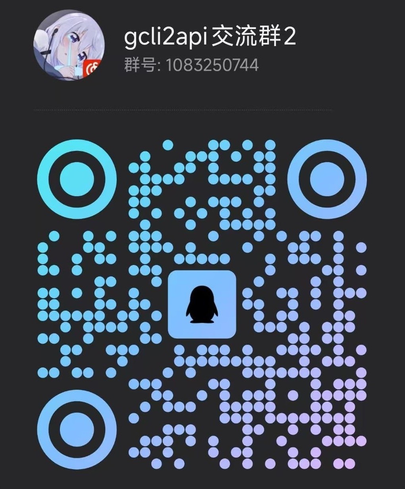

# AGY2API

**将 Google Antigravity 转换为 OpenAI、Gemini 和 Claude API 兼容接口**

[](https://www.python.org/downloads/)
[](LICENSE)
[](https://github.com/su-kaka/agy2api/pkgs/container/agy2api)

[English](docs/README_EN.md) | 中文 | [日本語](docs/README_JA.md)

> **⚠️ 重要变更**：GeminiCLI 端点已被谷歌抛弃，本项目已完全移除 GeminiCLI 相关代码，仅保留 Antigravity 模式。

## 安装指南

### Termux 环境

**初始安装**
```bash
curl -o termux-install.sh "https://raw.githubusercontent.com/su-kaka/agy2api/refs/heads/master/termux-install.sh" && chmod +x termux-install.sh && ./termux-install.sh
```

**重启服务**
```bash
cd agy2api
bash termux-start.sh
```

### Windows 环境

**初始安装**
```powershell
iex (iwr "https://raw.githubusercontent.com/su-kaka/agy2api/refs/heads/master/install.ps1" -UseBasicParsing).Content
```

**重启服务**
双击执行 `start.bat`

### Linux 环境

**初始安装**
```bash
curl -o install.sh "https://raw.githubusercontent.com/su-kaka/agy2api/refs/heads/master/install.sh" && chmod +x install.sh && ./install.sh
```

**重启服务**
```bash
cd agy2api
bash start.sh
```

### macOS 环境

**初始安装**
```bash
curl -o darwin-install.sh "https://raw.githubusercontent.com/su-kaka/agy2api/refs/heads/master/darwin-install.sh" && chmod +x darwin-install.sh && ./darwin-install.sh
```

**重启服务**
```bash
cd agy2api
bash start.sh
```

### Docker 环境

**Docker 运行命令**
```bash
docker run -d --name agy2api --network host -e API_PASSWORD=api_pwd -e PANEL_PASSWORD=panel_pwd -e PORT=7861 -v $(pwd)/data/creds:/app/creds -v $(pwd)/data/request_logs:/app/data/request_logs ghcr.io/su-kaka/agy2api:latest
```

**Docker Compose 运行命令**
1. 使用仓库中的 `docker-compose.yml`，或参考以下内容：
    ```yaml
    version: '3.8'

    services:
      agy2api:
        image: ghcr.io/su-kaka/agy2api:latest
        container_name: agy2api
        restart: unless-stopped
        network_mode: host
        environment:
          # 密码配置（分离密码）
          - API_PASSWORD=your_api_password
          - PANEL_PASSWORD=your_panel_password
          - PORT=7861
        volumes:
          - ./data/creds:/app/creds
          - ./data/request_logs:/app/data/request_logs
    ```
2. 启动服务：
    ```bash
    docker-compose up -d
    ```

## 核心功能

### 🔄 API 端点和格式支持

**Antigravity 多端点多格式支持**
- **OpenAI 格式端点**：`/v1/chat/completions` 和 `/v1/models`
- **Gemini 原生端点**：`/v1/models/{model}:generateContent` 和 `streamGenerateContent`
- **Claude 格式端点**：`/v1/messages`
- 支持所有 Antigravity 模型（Claude、Gemini 等）
- 自动模型名称映射和思维模式检测
- 多种认证方式：Bearer 头部、x-api-key、x-goog-api-key、URL 参数 key

### 📊 智能凭证管理系统

- 多个 Google OAuth 凭证自动轮换（随机负载均衡）
- 模型级冷却（429 错误自动设置对应模型家族的 CD：argon / gemini / claude+gpt 共享冷却）
- 自动故障检测和凭证禁用
- 凭证使用统计和配额/额度查询
- 批量操作（启用、禁用、删除）
- 以邮箱为唯一键，重复导入自动覆盖去重
- 自动获取 Google 账户邮箱地址、订阅等级（Tier）和 Project ID

### 🌊 流式传输和响应处理

- 真正的实时流式响应（SSE）
- 流式抗截断功能（防止回答被截断，通过"抗截断-"前缀启用）
- 思维链（Thinking）内容分离

### 🎛️ Web 管理控制台

基于 React + Vite + Tailwind 编译的现代化前端界面：
- Antigravity OAuth 认证流程（支持回调 URL 快捷方式）
- 凭证文件上传（JSON/ZIP）、下载、详情查看
- 凭证导出（规范 JSON：refresh_token/email/tier/project_id）
- 系统配置管理（环境变量锁定提示、热更新）
- 批量凭证操作和状态筛选、批量导入（缺失字段自动获取）
- 移动端自适应

## 支持的模型

模型列表从 Antigravity API 动态获取，支持所有 Antigravity 模型：

- **Claude 系列**：`claude-sonnet-4-5`、`claude-opus-4-5` 等
- **Gemini 系列**：`gemini-2.5-flash`、`gemini-3-flash-preview` 等

**特殊功能变体：**
- **抗截断模式**：在模型名称前添加 `抗截断-` 前缀
  - 例：`抗截断-gemini-2.5-pro`
  - 通过合成工具调用绕过截断限制，确保完整回答（流式和非流式均有效）
- **图像生成模型**支持分辨率（`-2k`、`-4k`）和比例（`-16x9`、`-9x16` 等）后缀

## 配置说明

1. 访问 `http://127.0.0.1:7861`（默认端口，可通过 PORT 环境变量修改）
2. 完成 Antigravity OAuth 认证流程（默认密码：`pwd`，可通过环境变量修改）
3. 配置客户端：

**OpenAI 兼容客户端：**
- **端点地址**：`http://127.0.0.1:7861/v1`
- **API 密钥**：`pwd`（默认值，可通过 API_PASSWORD 环境变量修改）

**Gemini 原生客户端：**
- **端点地址**：`http://127.0.0.1:7861`
- **认证方式**：`Authorization: Bearer 密钥`、`x-goog-api-key: 密钥` 或 URL 参数 `?key=密钥`

**Claude 客户端：**
- **端点地址**：`http://127.0.0.1:7861/v1/messages`
- **认证方式**：`x-api-key: 密钥` 或 `Authorization: Bearer 密钥`

## 💾 数据存储

### 存储后端

| 后端 | 说明 | 启用方式 |
|------|------|----------|
| **SQLite**（默认） | 本地文件存储，开箱即用 | 无需配置，数据存储在 `creds/credentials.db` |
| **PostgreSQL** | 云端分布式存储，多实例部署 | 设置 `POSTGRESQL_URI` 环境变量 |

### 凭证数据结构

凭证以**邮箱（email）为唯一键**存储，字段为结构化数据库列（不再使用 JSON blob）：
`email`、`access_token`、`refresh_token`、`client_id`、`client_secret`、`project_id`、`expiry`、`tier`

凭证导入/导出使用规范 JSON 格式：`{"refresh_token": "...", "email": "...", "tier": "...", "project_id": "..."}`（仅 `refresh_token` 必填，其余字段可自动获取）。

### 环境变量配置

**基础配置**
- `PORT`: 服务端口（默认：7861）
- `HOST`: 服务器监听地址（默认：0.0.0.0）

**密码配置**
- `API_PASSWORD`: 聊天 API 访问密码（默认：pwd）
- `PANEL_PASSWORD`: 控制面板访问密码（默认：pwd）

**访问控制配置**
- `IP_WHITELIST_ENABLED`: 启用 IP 白名单（默认：false，不限制）
- `IP_WHITELIST`: IP 白名单列表，逗号或换行分隔（默认：空）。每条支持单个 IP（`192.168.1.1`）、CIDR 网段（`192.168.1.0/24`）、起止范围（`10.0.0.1-10.0.0.100`），IPv4 / IPv6 均可。开启后仅白名单内 IP 可访问面板和 API，其余 IP 直接 403；面板保存后立即生效

**模型名复写配置**
- `MODEL_REWRITE_ENABLED`: 启用模型名复写（默认：false）
- `MODEL_REWRITE_RULES`: 复写规则，每条为 `[匹配正则, 替换模型名]`（默认：空）。自上而下首条命中即替换，替换支持正则反向引用（如 `\1`）。例：把 `gpt-4o` 映射到 `gemini-2.5-pro`。面板保存后立即生效

**存储配置**
- `CREDENTIALS_DIR`: 凭证数据库目录（默认：./creds）
- `POSTGRESQL_URI`: PostgreSQL 连接字符串（设置后启用 PostgreSQL 模式）

**网络和代理配置**
- `PROXY`: 代理地址（支持 `http://`、`https://`、`socks5://`、`socks5h://`，可带账号密码 `user:pass@host:port`）
- `OAUTH_PROXY_URL`: OAuth 认证代理端点
- `GOOGLEAPIS_PROXY_URL`: Google APIs 代理端点
- `ANTIGRAVITY_API_URL`: Antigravity API 端点

**性能和稳定性配置**
- `RETRY_429_ENABLED`: 启用错误自动重试（默认：true）
- `RETRY_429_MAX_RETRIES`: 最大重试次数（默认：5）
- `RETRY_429_INTERVAL`: 重试间隔，秒（默认：1）
- `ANTI_TRUNCATION_MAX_ATTEMPTS`: 抗截断最大重试次数（默认：3）

**自动化配置**
- `AUTO_BAN`: 启用凭证自动封禁（默认：false）
- `AUTO_BAN_ERROR_CODES`: 触发自动封禁的错误码（默认：403）

**响应行为配置**
- `RETURN_THOUGHTS_TO_FRONTEND`: 返回思维链到前端（默认：true）

**敏感词过滤配置**
- `SENSITIVE_WORDS_ENABLED`: 启用敏感词过滤（默认：false）
- `SENSITIVE_WORDS`: 敏感词列表，逗号或换行分隔（默认：空）。命中后整词替换为空，不区分大小写，支持中文，面板保存后立即生效

**请求日志配置**
- `USAGE_LOG_ENABLED`: 启用请求日志（默认：true）。记录每次 API 请求（模型、凭证、token 用量、耗时、状态）到数据库，不自动清理，可在面板手动清理或清空

**请求体详细日志配置**
- `REQUEST_LOG_ENABLED`: 启用请求体详细日志（默认：false）。开启后，当请求命中指定错误码时，把发往上游的完整请求头（已脱敏）与请求体保存为 JSON 文件到 `data/request_logs/`，数据库仅记录文件索引，在"请求日志"详情中查看。主要用于请求体错误时排查 debug；清理/清空日志时会同步删除对应文件（Docker 部署请挂载 `./data/request_logs:/app/data/request_logs` 以持久化）
- `REQUEST_LOG_ERROR_CODES`: 触发详细日志的错误码列表，逗号分隔（默认：400）

**凭证选择模式**
- `CREDENTIAL_SELECT_MODE`: 凭证选择模式（默认：cache）
  - `random` — 完全随机负载均衡，每次请求随机挑选凭证
  - `cache` — 缓存匹配（推荐）：以"模型 + system 指令（或首条 user 消息）"哈希会话 key，相同会话复用同一凭证，命中 Google 上游 prompt cache；凭证 CD 后自动切换并重新绑定
  - `sticky` — 凭证粘性：所有请求锁定同一凭证，直到其进入 CD 或被禁用
- `REDIS_URL`: Redis 连接串（可选）。设置后缓存匹配的会话绑定存入 Redis，多实例共享；未设置时使用进程内存后端

**日志配置**
- `LOG_LEVEL`: 日志级别（DEBUG/INFO/WARNING/ERROR，默认：INFO）
- `ENABLE_LOG`: 完全静默，不打印任何日志（设为 0 启用静默，默认：1）

## API 使用示例

### OpenAI 格式

```bash
curl -X POST "http://127.0.0.1:7861/v1/chat/completions" \
  -H "Authorization: Bearer your_api_password" \
  -H "Content-Type: application/json" \
  -d '{
    "model": "claude-sonnet-4-5",
    "messages": [
      {"role": "user", "content": "Hello"}
    ],
    "stream": true
  }'
```

### Gemini 原生格式

```bash
curl -X POST "http://127.0.0.1:7861/v1/models/gemini-2.5-flash:generateContent?key=your_api_password" \
  -H "Content-Type: application/json" \
  -d '{
    "contents": [
      {"role": "user", "parts": [{"text": "Hello"}]}
    ]
  }'
```

### Claude 格式

```bash
curl -X POST "http://127.0.0.1:7861/v1/messages" \
  -H "x-api-key: your_api_password" \
  -H "anthropic-version: 2023-06-01" \
  -H "Content-Type: application/json" \
  -d '{
    "model": "claude-sonnet-4-5",
    "max_tokens": 1024,
    "messages": [
      {"role": "user", "content": "Hello, Claude!"}
    ]
  }'
```

### 图像生成（Gemini 原生 SDK）

```python
from io import BytesIO
from PIL import Image
from google.genai import Client
from google.genai.types import HttpOptions
from google.genai import types

client = Client(
    api_key="pwd",
    http_options=HttpOptions(base_url="http://127.0.0.1:7861"),
)

prompt = "画一只猫"

response = client.models.generate_content(
    model="gemini-3.1-flash-image",
    contents=[prompt],
    config=types.GenerateContentConfig(
        image_config=types.ImageConfig(
            aspect_ratio="16:9",
        )
    )
)
for part in response.candidates[0].content.parts:
    if part.text is not None:
        print(part.text)
    elif part.inline_data is not None:
        image = Image.open(BytesIO(part.inline_data.data))
        image.save("generated_image.png")
```

## 🛠️ 前端开发

控制面板前端源码位于 `frontend/` 目录（React + Vite + Tailwind CSS）：

```bash
cd frontend
npm install
npm run dev     # 开发模式，端口 3000，代理后端 API
npm run build    # 构建到 dist/（生产模式使用）
```

后端直接托管 `dist/` 下编译后的静态文件，无需 Node.js 运行时。

## 💬 交流群

欢迎加入 QQ 群交流讨论！

**QQ 群号：1083250744**



## 许可证与免责声明

本项目仅供学习研究使用，禁止商业用途和倒卖。

## ⚠️ 许可证声明

本项目使用 [CNC-1.0 许可证](LICENSE)（反商业许可证）。
